# SOC Monitor Dashboard

A lab-focused Security Operations Center (SOC) dashboard that brings Wazuh security data into one interface. The project uses a Python/Flask backend and a browser-based frontend for alert monitoring, incident tracking, threat visibility, and analyst workflows in a virtualized cybersecurity lab.

> **Project status:** This is a learning and portfolio project, not a production-ready managed SOC service. Features marked **Soon**, including AI Analysis, are planned and should not be treated as implemented capabilities.

## Project Highlights

- Wazuh-based security alert monitoring
- Suricata network detection in the lab
- Incident tracking and investigation views
- Endpoint and agent visibility
- MITRE ATT&CK-oriented alert context
- Response playbook interface
- Reports and threat-intelligence views
- Flask backend with a browser-based dashboard

## Lab Architecture

The lab contains separate Ubuntu virtual machines for the Wazuh server and the monitored target. The target runs the Wazuh agent and Suricata. Kali Linux is used to generate controlled test activity against the lab target.

```text
             Controlled test activity
                       |
                       v
                +-------------+
                | Kali Linux  |
                |  Attacker   |
                +-------------+
                       |
                       v
          +---------------------------+
          | Ubuntu Target             |
          | Wazuh Agent + Suricata    |
          +---------------------------+
                       |
                       | Agent events / collected logs
                       v
          +---------------------------+
          | Ubuntu Wazuh Server       |
          | Wazuh Manager / Indexer*  |
          +---------------------------+
                       |
                       | Wazuh API / Indexer data
                       v
          +---------------------------+
          | SOC Monitor Dashboard     |
          | Flask backend + frontend  |
          +---------------------------+
```

\*The diagram groups Wazuh Manager and Indexer under the Wazuh server role; confirm their exact installation layout if you later document the VM configuration in more detail. Suricata alerts appear in Wazuh and the custom dashboard only when Suricata log collection and the relevant Wazuh integration are configured correctly.

### Lab Components

- **Kali Linux:** Used for controlled attack simulation and security testing.
- **Ubuntu target:** Runs the Wazuh agent and Suricata.
- **Ubuntu Wazuh server:** Receives and processes security events from the monitored endpoint.
- **SOC Monitor Dashboard:** Uses the configured Wazuh data source to display alert and incident information.

## Screenshots

The screenshots below are stored in the repository's `screenshots/` directory. Image links are relative to the project root; the filenames must match exactly.

### SOC Dashboard

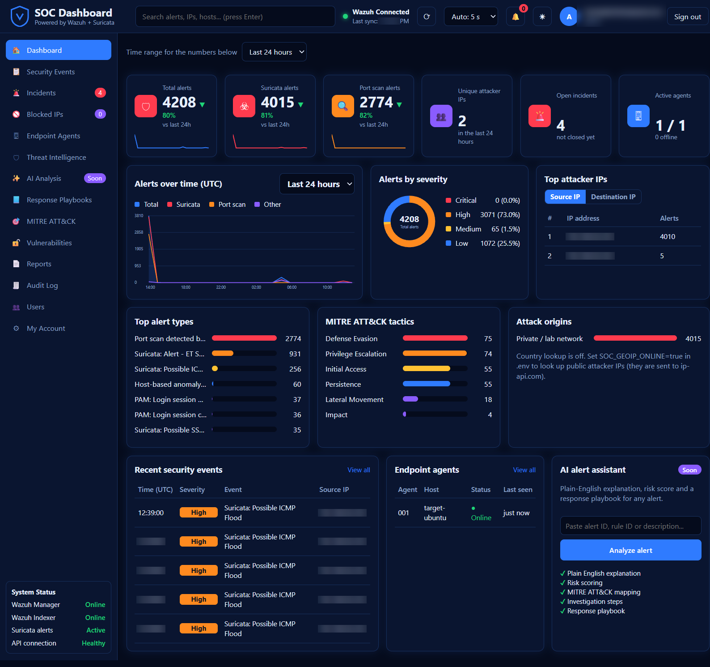

### Incident Management

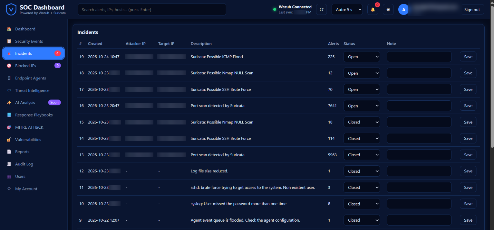

### Endpoint Agents

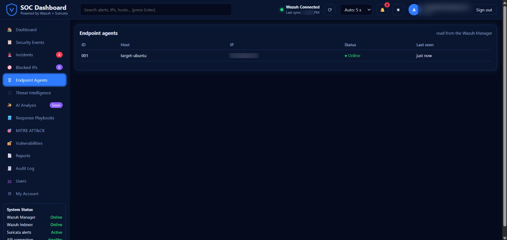

### Threat Intelligence

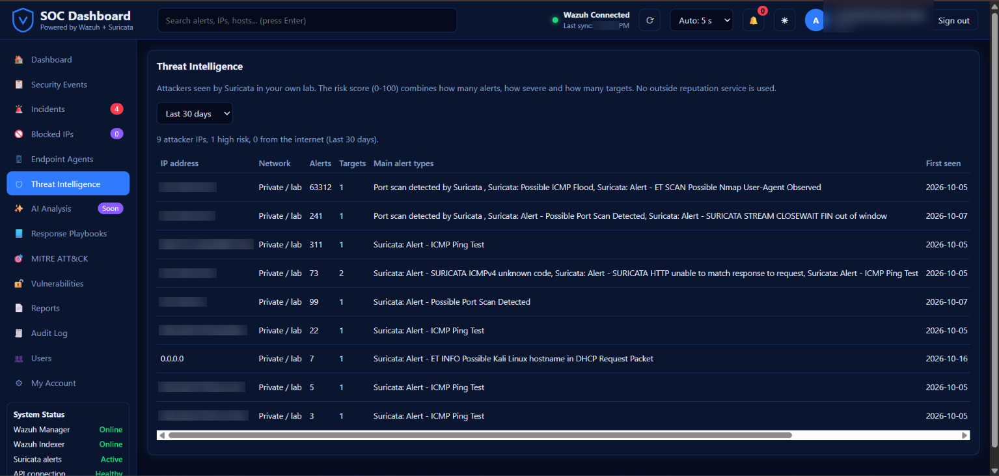

### MITRE ATT&CK

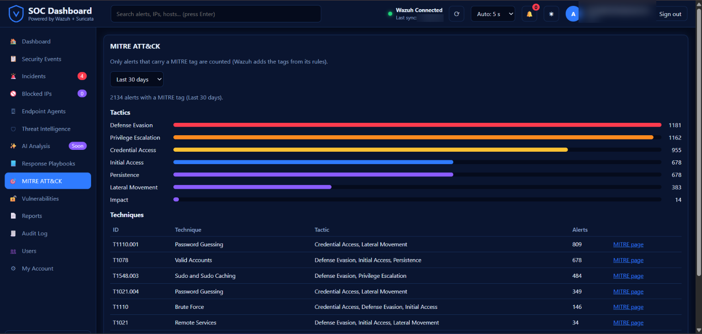

### Response Playbooks

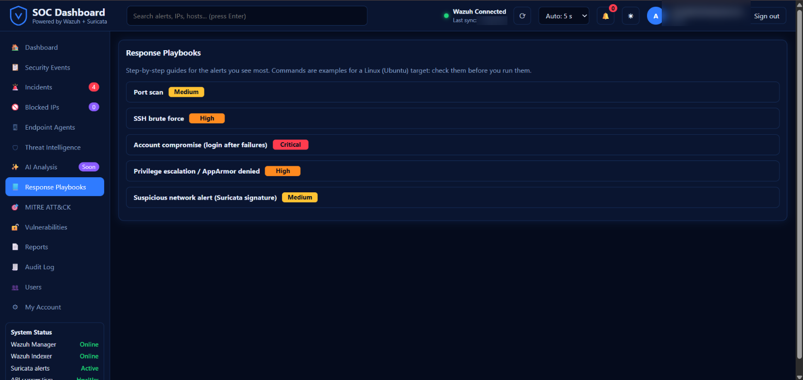

### Reports

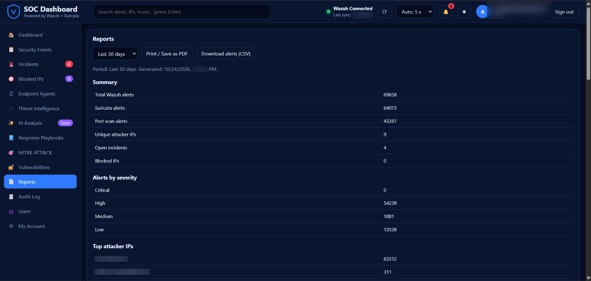

### Wazuh Custom Rules

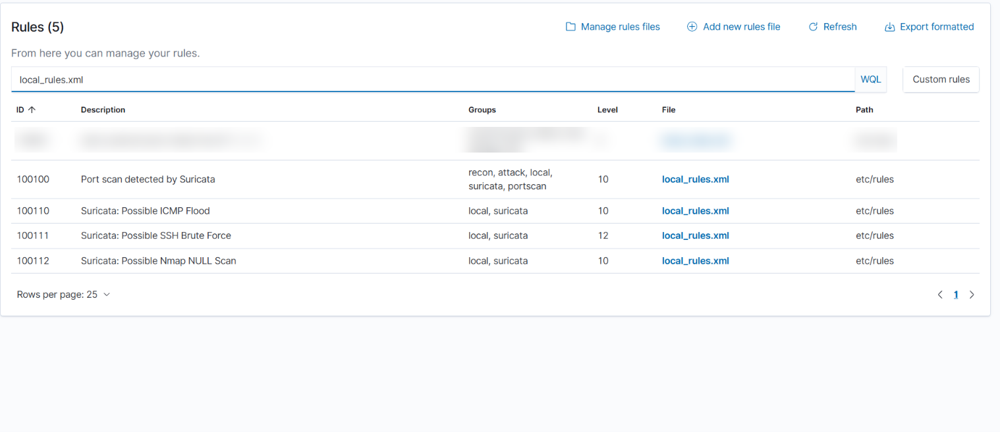

### Suricata Detection Evidence

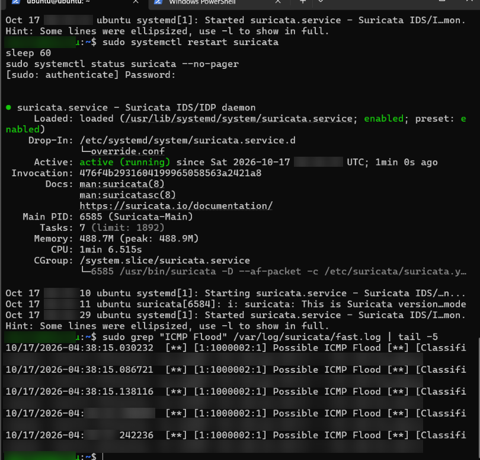

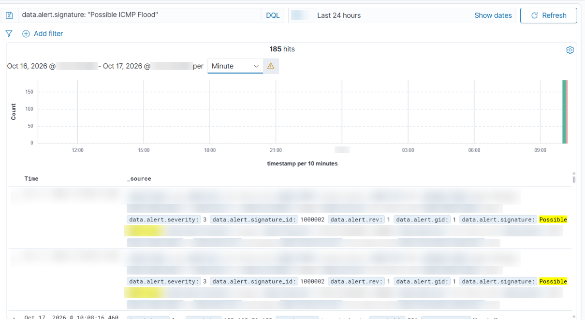

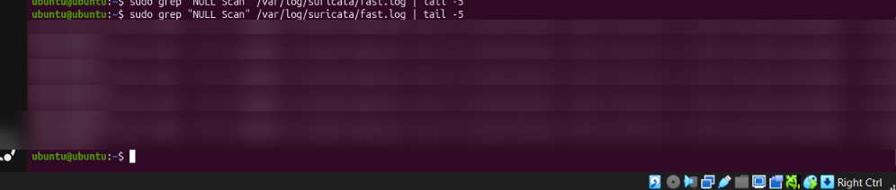

### Telegram Notifications

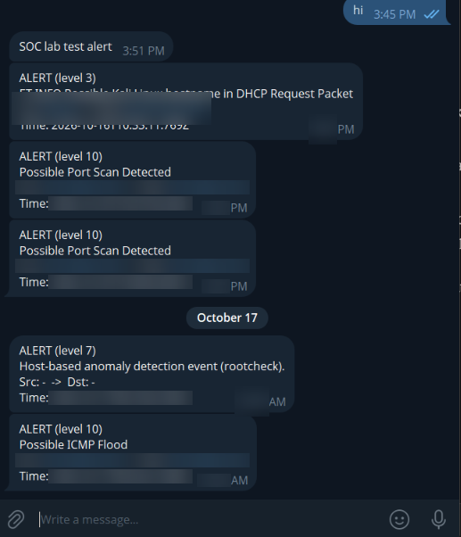

## Wazuh Monitoring Screenshots

The following screenshots show the Wazuh web interface used in the lab.

### Wazuh Overview

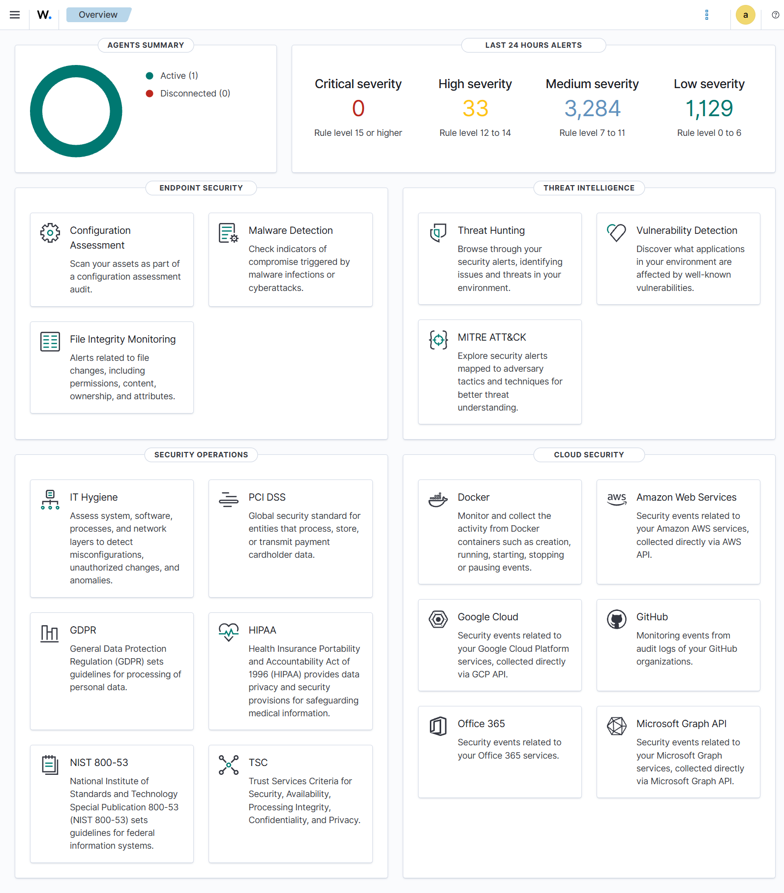

### Wazuh Threat Hunting

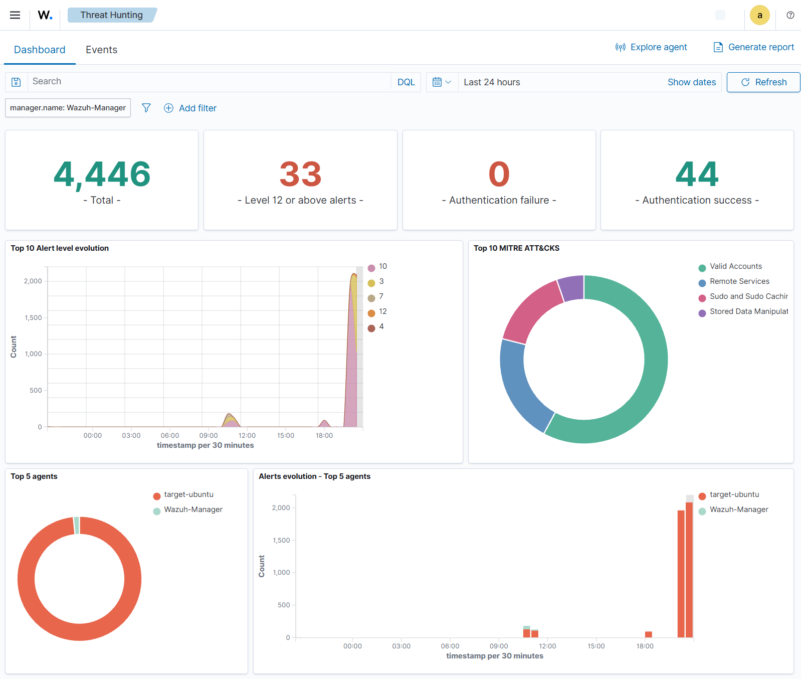

> `wazuh-server-overview.png` is a Wazuh login screen, so it is not presented as a server dashboard screenshot.

## Technology Stack

- **Backend:** Python, Flask
- **Frontend:** HTML, CSS, JavaScript
- **Security monitoring:** Wazuh
- **Network detection:** Suricata
- **Local application data:** SQLite
- **Lab environment:** Virtual machines running Ubuntu and Kali Linux

## Setup

The commands below assume Python and Git are installed. Run them from the project root in PowerShell.

### 1. Create and activate a virtual environment

```powershell
python -m venv .venv
.\.venv\Scripts\Activate.ps1
```

### 2. Install dependencies

```powershell
pip install -r requirements.txt
```

### 3. Configure environment variables

If this project version uses a local `.env` file, create it from the example and set the correct lab-specific values.

```powershell
Copy-Item .env.example .env
```

Keep real passwords, API credentials, secret keys, and other private values in your local `.env` file. Never commit real secrets to GitHub. Review the example configuration before starting the application; example values are not working credentials.

### 4. Start the application

Use the supplied startup script if that matches your local setup:

```powershell
.\start.bat
```

If you normally use a different documented command for this project version, follow that local configuration.

## Security Notes

- Test only systems and IP addresses you own or are explicitly authorized to test.
- Keep real credentials in a local `.env` file and out of Git.
- Change default or example credentials before using the lab.
- Review screenshots for usernames, email addresses, tokens, and internal details before publishing.
- This is a lab/portfolio project, not a production-ready SOC service.
- Active Response behaviour depends on local configuration. Verify whether actions are in dry-run or enforcement mode before testing.

## Testing

The repository contains test and audit scripts. Run the checks documented for your project version and review their output before making changes. Passing local tests does not by itself constitute a complete security audit.

## Project Structure

```text
soc-dashboard/
├── backend/
│   ├── services/
│   └── wazuh/
├── data/
├── frontend/
│   ├── css/
│   └── js/
├── screenshots/
├── tests/
├── .env.example
├── .gitignore
├── requirements.txt
├── start.bat
└── README.md
```

## Limitations

- This is a lab/portfolio project and should not be treated as a production deployment.
- Alert visibility depends on Wazuh connectivity, indexer availability, agent status, and log collection configuration.
- Suricata data visibility depends on its configured log output and Wazuh integration.
- AI Analysis is planned if shown as **Soon** in the current UI; it is not claimed as implemented here.

## License

See the [`LICENSE`](LICENSE) file for the project's license.
